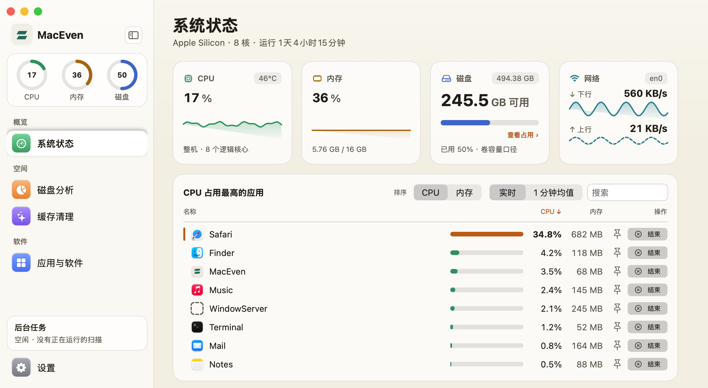
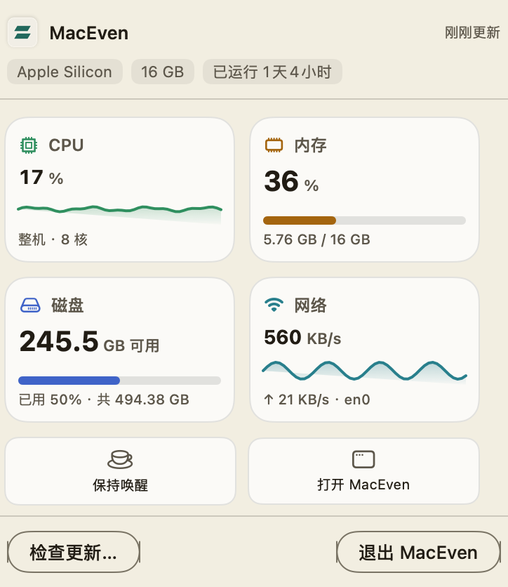

<div align="center">

# MacEven

**看清 Mac 的系统状态与磁盘占用，确认后再清理。**

**See what is using your Mac's resources and storage. Clean up with confidence.**

免费开源 · 文件扫描与清理在本机完成 / Free & open source · File scanning and cleanup stay on your Mac

[English](#english) · [中文](#中文)




如果 MacEven 对你有帮助，欢迎 [⭐ 点个 Star 支持](https://github.com/funny-dog/MacEven)，也欢迎反馈使用问题。

If MacEven helps you, [⭐ star the project on GitHub](https://github.com/funny-dog/MacEven). Feedback is welcome too.

</div>

---

## 中文

MacEven 是原生 macOS 系统监控与磁盘管理工具，使用 Swift / SwiftUI 开发，无第三方运行依赖。默认使用简洁模式，需要更多指标和诊断信息时可在设置中切换高级模式。

### ✨ 功能

- 🌐 **中英文界面** —— 随系统语言切换：中文系统显示中文，其他语言显示英文；文件名、路径和已保存的原始记录保持原样。
- 📊 **系统状态** —— 查看 CPU、内存、磁盘、网络、进程占用与历史趋势，也可直接从菜单栏查看。
- 🗂 **磁盘分析** —— 按目录、类别和用途查看占用，提供大文件列表与空间地图，支持取消扫描并浏览部分结果。
- 🧹 **缓存清理** —— 检查应用、开发工具和浏览器缓存，以及卸载残留；应用缓存根据已安装应用的包元数据发现，保留账户、配置和文稿等内容。
- 🤖 **AI 清理与维护** —— 分析 AI 工具缓存、诊断日志和工作资料；会话与工作记录可单独确认清理，另有默认未勾选的「工作资料与记忆」目录清理入口。
- 📦 **应用与软件** —— 统计应用本体及可识别关联数据，支持批量卸载、软件更新检查、Homebrew 更新和启动项管理。
- 🔍 **重复文件** —— 按磁盘或文件夹扫描，经过大小筛选、抽样、完整哈希与逐字节核对；复用哈希缓存和文件系统事件加速后续扫描。

### 📸 截图

<p align="center">
  
</p>

### 📥 安装

> 预编译发行包面向 **Apple Silicon（M 系列芯片）**，要求 **macOS 14.0+**。Intel 构建尚未验证。

1. 下载 **[MacEven.dmg](https://github.com/funny-dog/MacEven/releases/latest/download/MacEven.dmg)**，此链接始终指向最新正式版。
2. 打开 DMG，将 `MacEven.app` 拖入 `Applications`。
3. 当前发行包使用固定自签名证书，未经 Apple 公证。确认下载来源后，如首次打开被系统拦截，可在终端执行：
   ```bash
   xattr -dr com.apple.quarantine /Applications/MacEven.app
   ```
   然后重新打开应用。
4. 按需在「系统设置 → 隐私与安全性 → 完全磁盘访问权限」授权，再重新启动应用并扫描。未授权时，受保护目录可能无法统计；辅助功能权限为可选增强权限，可在应用设置中查看引导。

### 🔄 升级

在应用菜单中选择「检查更新…」，或下载最新 DMG，退出旧版后覆盖安装。

自动更新需要 ZIP 及 SHA-256 校验信息，安装前还会核对新包与当前版本的签名证书。发布时沿用同一证书和应用标识；从 ad-hoc 签名迁移或更换证书后，可能需要重新授予系统权限。私钥丢失会影响后续自动更新。

### 🛡 清理与隐私

- 所有文件清理都需要确认，并移到系统废纸篓；不永久删除、不清空废纸篓。移走后不会立即释放空间，可以在 Finder 中恢复。
- 常规缓存、应用卸载和重复文件流程按对应规则复核文件身份、保护项、占用和路径边界，批量操作显示逐项结果。
- **工作资料与记忆属于高风险目录操作**：选中目录可能包含长期记忆、配置、凭据、生成产物及未提交源码或工作树。默认不选，不加入普通缓存的一键清理；可手动勾选并单独确认整体移到废纸篓。建议保留；操作前请自行备份、退出相关工具并核对完整路径。
- 磁盘分析只读元数据，重复检测会读取文件内容；扫描不跟随符号链接，也不跨越范围之外的挂载卷。
- APFS 克隆、快照、压缩和共享块会影响占用估算，显示大小不等于实际可释放空间。访问受限或取消会产生部分结果。
- 文件扫描与清理在本机进行；更新检查会联系应用更新源、GitHub、Apple 或 Homebrew 服务。历史报告只供查看，重启后需要重新扫描才能清理。

### 🛠 从源码构建

需要支持 Swift 6 的 Xcode 或 Command Line Tools。构建脚本生成当前 Mac 架构的应用包。

```bash
bash scripts/setup-signing.sh       # 仅首次：生成固定自签名证书；请备份私钥
bash scripts/verify.sh --fast        # 常规检查、轻量探针与构建，不安装
bash scripts/build.sh               # 构建并安装到 /Applications/MacEven.app
```

只构建应用用 `bash scripts/build.sh --build-only`；生成 DMG、ZIP 与校验和用 `bash scripts/build.sh --package`。未找到证书时，本地构建退回 ad-hoc 签名；正式发布应使用固定证书。

维护者的版本、验证、标签、CI 和发布步骤见 **[发布流程](docs/releasing.md)**。

### ⚠️ 已知限制

温度、风扇、电池等指标取决于硬件和系统接口，无法获取时明确标注。软件更新覆盖取决于可识别的更新源；现代后台项通过系统设置管理。文件系统持续变化，扫描结果不是瞬时快照，最后一次核验与移动之间仍存在竞争窗口。

### 📄 许可证

[MIT](LICENSE)

---

## English

MacEven is a native macOS system monitor and storage manager built with Swift and SwiftUI, with no third-party runtime dependencies. It starts in Simple mode; switch to Advanced mode in Settings for more metrics and diagnostics.

### ✨ Features

- 🌐 **Chinese and English** — follows the system language: Chinese on Chinese systems, English otherwise. Filenames, paths and previously saved records retain their original text.
- 📊 **System status** — CPU, memory, disk, network, processes and historical trends, with a menu bar panel for quick checks.
- 🗂 **Disk analysis** — browse storage by folder, category or purpose, find large files, and explore a storage map. Cancel a scan and browse its partial results.
- 🧹 **Cache cleanup** — inspect application, developer and browser caches, plus app leftovers. App metadata helps identify cache locations while accounts, settings and documents are preserved.
- 🤖 **AI cleanup and maintenance** — inspect AI tool caches, diagnostic logs and working data. Sessions and work records require separate confirmation. A separate working-data and memories cleanup option is unselected by default.
- 📦 **Apps and software** — measure apps and recognized associated data, uninstall in batches, check software updates, update Homebrew packages and manage startup items.
- 🔍 **Duplicate files** — scan disks or a folder using size filtering, sampling, full hashes and byte comparisons. Hash caches and filesystem events speed up later scans.

### 📸 Screenshots

The screenshots above show the Chinese interface.

### 📥 Installation

> Pre-built releases target **Apple Silicon (M-series)** Macs running **macOS 14.0+**. Intel builds have not been verified.

1. Download **[MacEven.dmg](https://github.com/funny-dog/MacEven/releases/latest/download/MacEven.dmg)**, which always points to the latest stable release.
2. Open the DMG and drag `MacEven.app` into `Applications`.
3. Releases use a fixed self-signed certificate and are not notarized by Apple. If macOS blocks the first launch, verify the download source, then run:
   ```bash
   xattr -dr com.apple.quarantine /Applications/MacEven.app
   ```
   Open the app again.
4. Grant Full Disk Access under System Settings → Privacy & Security if needed, then restart the app and scan again. Without it, some protected folders cannot be measured. Accessibility is an optional permission; the app's Settings includes guidance.

### 🔄 Upgrading

Choose “Check for Updates…” from the application menu, or download the latest DMG, quit the old app and replace it.

Automatic updates require a ZIP and SHA-256 checksum information. Before installation, MacEven also checks that the new app uses the same signing certificate as the installed version. Releases keep the same certificate and bundle identifier. Moving from ad-hoc signing or changing certificates may require permissions to be granted again; losing the private key affects future automatic updates.

### 🛡 Cleanup and privacy

- File cleanup requires confirmation and moves items to the system Trash. MacEven does not permanently delete files or empty the Trash. Space is not freed immediately; items can be restored in Finder.
- Cache, app uninstall and duplicate-file workflows recheck file identity, protection rules, activity and path boundaries as applicable. Batch results are reported individually.
- **Working-data and memories cleanup is a high-risk directory operation.** Selected directories can contain long-term memories, settings, credentials, generated work and uncommitted source code or worktrees. They are unselected by default and excluded from ordinary one-click cache cleanup. Selecting and separately confirming this option moves entire selected directories to Trash. Keeping them is recommended; back them up, quit the relevant tools and verify full paths before proceeding.
- Disk analysis reads metadata; duplicate detection reads file contents. Scans do not follow symbolic links or cross mounts outside their scope.
- APFS clones, snapshots, compression and shared blocks affect estimates. Reported sizes are not a promise of reclaimable space. Permission limits and cancelled scans produce partial results.
- File scanning and cleanup happen locally. Update checks contact application update sources, GitHub, Apple or Homebrew. Saved reports are informational; cleanup requires a fresh scan after restarting.

### 🛠 Build from source

Install Xcode or Command Line Tools with Swift 6 support. The build script produces an app for the current Mac's architecture.

```bash
bash scripts/setup-signing.sh       # first time only; back up the signing private key
bash scripts/verify.sh --fast        # routine checks, small probes and build; no installation
bash scripts/build.sh               # build and install into /Applications/MacEven.app
```

Use `bash scripts/build.sh --build-only` to build without installing, or `bash scripts/build.sh --package` to create DMG, ZIP and checksum files. Local builds fall back to ad-hoc signing if the certificate is missing; public releases should use the fixed certificate.

Maintainers: see the **[release workflow](docs/releasing.md)** for versioning, verification, tags, CI and publishing.

### ⚠️ Known limitations

Temperature, fan and battery readings depend on hardware and system interfaces; unavailable values are labelled. Software update coverage depends on recognized update sources. Modern background items are managed through System Settings. The filesystem keeps changing, scans are not point-in-time snapshots, and a race remains between the final check and moving a file.

### 📄 License

[MIT](LICENSE)
